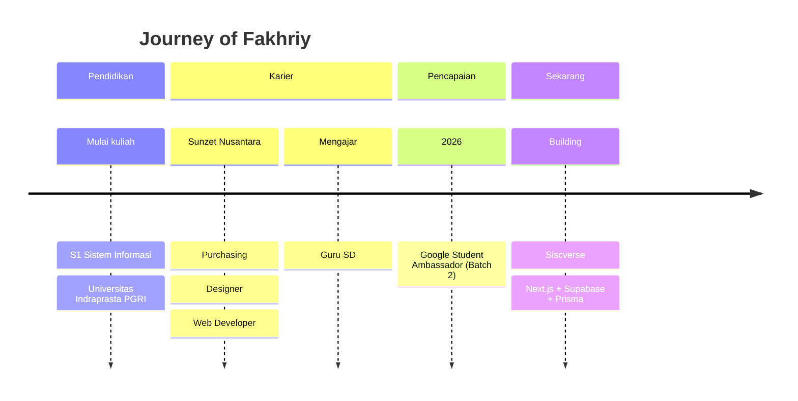

<!-- ============================================================
     GANTI: USERNAME_GITHUB_ANDA, email_anda@gmail.com, username_linkedin_anda
     ============================================================ -->

<div align="center">
  
</div>

<div align="center">
  <a href="https://fakhriyvision.vercel.app">
    
  </a>
</div>

<br>

<div align="center">
  <a href="https://fakhriyvision.vercel.app"></a>
  
  
</div>

<div align="center">
  
  
  
</div>

<br>

<div align="center">
  
  
  
</div>


## 🧬 &nbsp;Tentang Saya

<table align="center" border="0">
<tr>
<td width="55%" valign="top">

```js
const fakhriy = {
  nama: "Muhammad Fakhriy Rahman",
  peran: [
    "Full-Stack Developer",
    "UI/UX Designer",
    "Purchasing & Operations",
  ],
  kampus: "Universitas Indraprasta PGRI",
  jurusan: "S1 Sistem Informasi",
  penghargaan: "Google Student Ambassador 2026",
  bekerjaDi: "Sunzet Nusantara (F&B)",
  sedangDibangun: "Siscverse 🎓",
  profesiLain: "Guru SD 👨‍🏫",
  hobi: ["Membaca buku 📚", "Desain 🎨"],
  filosofi: "Teknologi + Desain + Manajemen",
};
```

</td>
<td width="45%" valign="top">

**Saya memadukan tiga dunia:**

🧑‍💻 **Engineering**: membangun aplikasi web modern dari frontend sampai backend.

🎨 **Design**: merancang UI/UX yang rapi, estetik, dan fungsional.

📦 **Operations**: memahami alur purchasing & bisnis F&B secara langsung.

🏫 **Education**: mengabdi sebagai guru SD dan membangun teknologi untuk kelas digital.

</td>
</tr>
</table>


## 🌟 &nbsp;Highlight

<div align="center">
<table>
<tr>
<td align="center" width="25%">
<h1>🌟</h1>
<b>Google Student<br>Ambassador</b><br>
<sub>2026 • Batch 2</sub>
</td>
<td align="center" width="25%">
<h1>🚀</h1>
<b>Siscverse</b><br>
<sub>Platform kelas digital<br>Next.js • Supabase • Prisma</sub>
</td>
<td align="center" width="25%">
<h1>💼</h1>
<b>Sunzet Nusantara</b><br>
<sub>Purchasing • Designer<br>Web Developer</sub>
</td>
<td align="center" width="25%">
<h1>🎓</h1>
<b>Sistem Informasi</b><br>
<sub>Universitas<br>Indraprasta PGRI</sub>
</td>
</tr>
</table>
</div>


## 🚀 &nbsp;Proyek Unggulan

<div align="center">
<table>
<tr>
<td width="50%" valign="top">

### 🎓 Siscverse
*Platform aplikasi web kelas digital modern*

Ruang belajar-mengajar digital yang interaktif, cepat, dan mudah dipakai guru maupun siswa.


`Next.js` `Supabase` `Prisma` `Tailwind`

🔨 **Status:** In Development

</td>
<td width="50%" valign="top">

### 🌐 Fakhriy Vision
*Portofolio interaktif pribadi*

Website portofolio modern untuk menampilkan karya, pengalaman, dan identitas visual saya.


[](https://fakhriyvision.vercel.app)

</td>
</tr>
</table>
</div>

> 📌 Pin repository terbaikmu di profil GitHub, atau tambahkan kartu repo di bawah ini:

<!--
<div align="center">
  <a href="https://github.com/USERNAME_GITHUB_ANDA/NAMA_REPO">
    
  </a>
</div>
-->


## 🛠️ &nbsp;Tech Stack & Tools

<div align="center">

| Kategori | Teknologi |
|:--|:--|
| 🎨 **Frontend & Frameworks** |  |
| ⚙️ **Backend, Database & Cloud** |  |
| 🧩 **Design & Workflow** |  |

</div>

<details>
<summary><b>⚡ Klik untuk melihat level keahlian</b></summary>
<br>

<div align="center">


</div>

</details>


## 🗺️ &nbsp;Perjalanan Saya




## 🏆 &nbsp;GitHub Trophies

<div align="center">
  <a href="https://github.com/ryo-ma/github-profile-trophy">
    
  </a>
</div>

## 📊 &nbsp;GitHub Dashboard

<table align="center" border="0" cellpadding="0" cellspacing="0">
  <tr>
    <td align="center" width="50%">
      
    </td>
    <td align="center" width="50%">
      
    </td>
  </tr>
</table>

<div align="center">
  
  
</div>

### 📈 Grafik Aktivitas

<div align="center">
  
</div>


## 🐍 &nbsp;Contribution Snake

> *Aktif setelah workflow `snake.yml` dijalankan (lihat panduan di bawah).*

<div align="center">
  <picture>
    <source media="(prefers-color-scheme: dark)" srcset="https://raw.githubusercontent.com/USERNAME_GITHUB_ANDA/USERNAME_GITHUB_ANDA/output/github-contribution-grid-snake-dark.svg">
    <source media="(prefers-color-scheme: light)" srcset="https://raw.githubusercontent.com/USERNAME_GITHUB_ANDA/USERNAME_GITHUB_ANDA/output/github-contribution-grid-snake.svg">
    
  </picture>
</div>


## 💬 &nbsp;Quote of the Day

<div align="center">
  
</div>


## 📫 &nbsp;Let's Connect!

<div align="center">
  <a href="https://fakhriyvision.vercel.app" target="_blank">
    
  </a>
  <a href="mailto:email_anda@gmail.com" target="_blank">
    
  </a>
  <a href="https://linkedin.com/in/username_linkedin_anda" target="_blank">
    
  </a>
</div>

<br>

<div align="center">
  
</div>

<div align="center">
  
</div>
