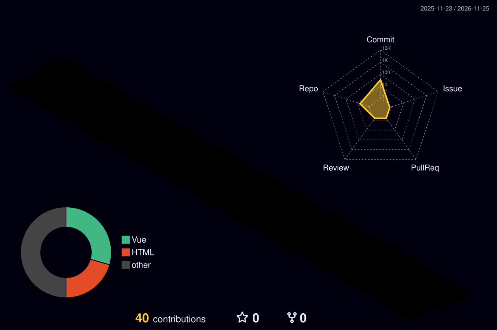

  

  

 

  
  
  

  
  
  

 

  
  
  
  

## 👨‍💻 &nbsp;Tentang Saya

> *"Memadukan teknologi, desain, dan pendidikan untuk membangun produk yang benar-benar berguna."*

Saya **Muhammad Fakhriy Rahman**, seorang **Full-Stack Developer** dan mahasiswa Sistem Informasi yang memadukan keahlian teknologi, desain UI/UX, dan manajerial operasional.

  

 

<table>
  <tr>
    <td width="50%" valign="top">

### 🎯 Saat Ini
- 🚀 Membangun **Siscverse**, platform kelas digital modern
- 🎓 S1 Sistem Informasi, **Universitas Indraprasta PGRI**
- 🌟 **Google Student Ambassador 2026 (Batch 2)**
- 💼 **Purchasing · Designer · Web Developer** di **Sunzet Nusantara** (F&B)

    </td>
    <td width="50%" valign="top">

### 🌱 Di Luar Layar
- 👨‍🏫 Aktif mengabdi sebagai **guru SD**
- 📚 Hobi **membaca buku**
- 🎨 Suka mengeksplorasi desain UI/UX
- 🤝 Terbuka untuk kolaborasi dan diskusi teknologi

    </td>
  </tr>
</table>

## 🚀 &nbsp;Proyek Unggulan

| Proyek | Deskripsi | Stack |
|:--|:--|:--|
| 🌌 **Siscverse** | Platform aplikasi web kelas digital modern untuk pembelajaran yang interaktif dan terstruktur. |    |
| 🌐 **Portfolio Interaktif** | Portofolio pribadi dengan tampilan modern dan interaktif. [Kunjungi →](https://fakhriyvision.vercel.app) |  |

<!--
  TIP: Untuk menampilkan repo pilihan sebagai kartu, tambahkan baris berikut (ganti NAMA-REPO):
  
-->

## 🛠️ &nbsp;Tech Stack & Tools

| Kategori | Teknologi |
|:--|:--|
| 🎨 **Frontend & Frameworks** |  |
| ⚙️ **Backend, Database & Cloud** |  |
| 🧩 **Design & Workflow** |  |

## 📊 &nbsp;GitHub Dashboard

<table align="center" border="0" cellpadding="0" cellspacing="0">
  <tr>
    <td align="center" width="50%">
      
    </td>
    <td align="center" width="50%">
      
    </td>
  </tr>
</table>

  
  

<b>📈 Lihat statistik lengkap</b>

 

  
  
  

## 🔥 &nbsp;Aktivitas Kontribusi

  

<b>🧊 Contribution 3D</b>

 

  <picture>
    <source media="(prefers-color-scheme: dark)" srcset="./profile-3d-contrib/profile-night-rainbow.svg">
    <source media="(prefers-color-scheme: light)" srcset="./profile-3d-contrib/profile-gitblock.svg">
    
  </picture>

<b>🐍 Contribution Snake</b>

 

  <picture>
    <source media="(prefers-color-scheme: dark)" srcset="https://raw.githubusercontent.com/fakhriy574/fakhriy574/output/github-contribution-grid-snake-dark.svg">
    <source media="(prefers-color-scheme: light)" srcset="https://raw.githubusercontent.com/fakhriy574/fakhriy574/output/github-contribution-grid-snake.svg">
    
  </picture>

## 📫 &nbsp;Let's Connect!

  
<i>Punya ide proyek, tawaran kolaborasi, atau sekadar ingin berdiskusi? Saya senang mendengarnya.</i>

  
  
  

 

  

