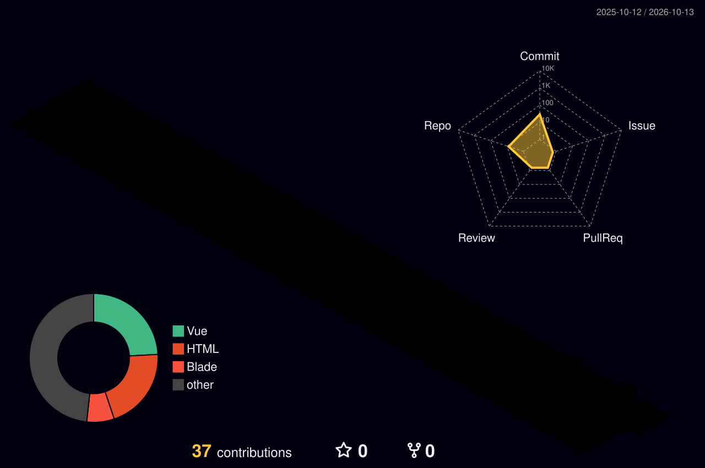

  

  

 

  
  
  

  
  
  

 

  
  
  

## 👨‍💻 &nbsp;Tentang Saya

Saya adalah seorang **Full-Stack Developer** dan Mahasiswa Sistem Informasi yang memadukan keahlian teknologi, desain UI/UX, dan manajerial operasional.

  

 

- 🎓 Sedang menempuh S1 Sistem Informasi di **Universitas Indraprasta PGRI**.
- 🌟 Terpilih sebagai **Google Student Ambassador 2026 (Batch 2)**.
- 💼 Berpengalaman di industri F&B, **Sunzet Nusantara**, memegang peran ganda dalam bidang **Purchasing, Designer, dan Web Development**.
- 💻 Saat ini sedang mengembangkan **Siscverse**, platform aplikasi web kelas digital modern dengan *stack* Next.js, Supabase, dan Prisma.
- 👨‍🏫 Di luar dunia *engineering*, saya aktif mengabdi sebagai guru SD dan memiliki hobi membaca buku.
- 🌐 Kunjungi portofolio interaktif saya: **[fakhriyvision.vercel.app](https://fakhriyvision.vercel.app)**

## 🛠️ &nbsp;Tech Stack & Tools

| Kategori | Teknologi |
|:--|:--|
| 🎨 **Frontend & Frameworks** |  |
| ⚙️ **Backend, Database & Cloud** |  |
| 🧩 **Design & Workflow** |  |

## 📊 &nbsp;GitHub Dashboard

<table align="center" border="0" cellpadding="0" cellspacing="0">
  <tr>
    <td align="center" width="50%">
      
    </td>
    <td align="center" width="50%">
      
    </td>
  </tr>
</table>

 

  
  
  
  

## 🧊 &nbsp;Contribution 3D

*(Catatan: grafik ini muncul setelah workflow `profile-assets.yml` dijalankan sekali di tab Actions)*

  <picture>
    <source media="(prefers-color-scheme: dark)" srcset="./profile-3d-contrib/profile-night-rainbow.svg">
    <source media="(prefers-color-scheme: light)" srcset="./profile-3d-contrib/profile-gitblock.svg">
    
  </picture>

## 🐍 &nbsp;Contribution Activity

*(Catatan: Animasi ini akan muncul setelah Anda mengaktifkan GitHub Actions di repository Anda)*

  <picture>
    <source media="(prefers-color-scheme: dark)" srcset="https://raw.githubusercontent.com/fakhriy574/fakhriy574/output/github-contribution-grid-snake-dark.svg">
    <source media="(prefers-color-scheme: light)" srcset="https://raw.githubusercontent.com/fakhriy574/fakhriy574/output/github-contribution-grid-snake.svg">
    
  </picture>

## 📫 &nbsp;Let's Connect!

  
  
  

 

  

